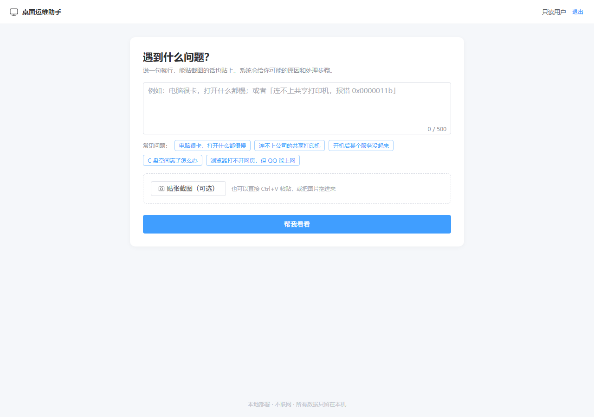
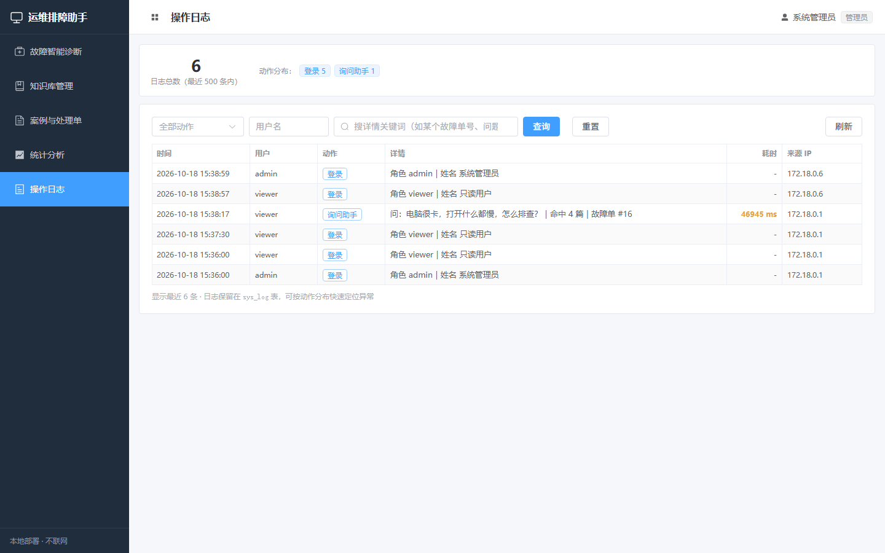
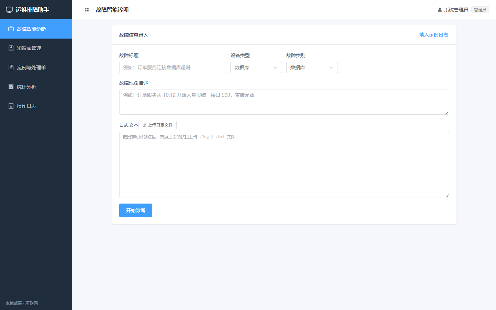
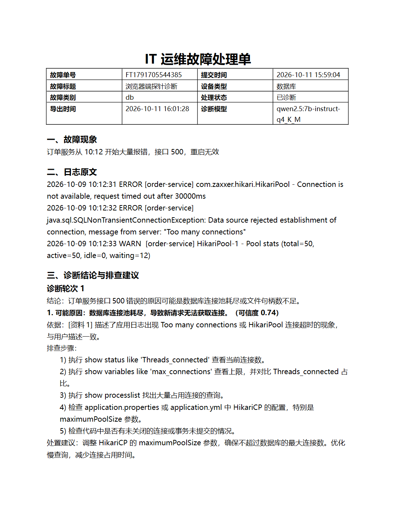
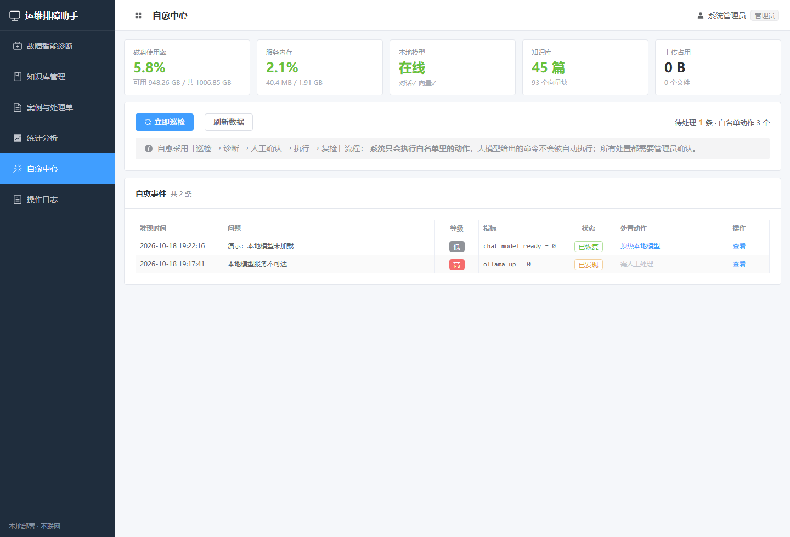

# IT 运维故障智能辅助排查工具

> 一个**完全本地运行**的 IT 运维排障助手。
> 输入故障现象和日志，本地大模型结合本地知识库给出「可能原因 → 排查步骤 → 处置建议」，
> 并逐条标注引用了知识库里的哪条资料。**不调用任何外部 API，不依赖云服务，数据全部留在本机。**

<p>
  
  
  
  
  
  
</p>

## 界面预览

| 普通用户（极简问答） | 运维管理端（操作日志） |
| --- | --- |
|  |  |

| 管理端诊断页 | 导出的 Word 处理单 |
| --- | --- |
|  |  |

## 核心特性

| 特性 | 说明 |
| --- | --- |
| 🔒 **全本地运行** | 大模型（Ollama）、向量检索、数据库全部跑在本机，断网也能用 |
| 🧠 **RAG 检索增强** | 日志先做模板化预处理 → bge-m3 转成 1024 维向量检索 → 交给 qwen2.5 生成结构化建议 |
| 📎 **结论有据可查** | 每条原因都带 `[资料N]` 引用，可回溯到知识库原文 |
| 👥 **角色分离** | 普通用户只看到极简问答页；运维人员有完整管理台和操作日志 |
| 🩺 **自愈能力** | 定时巡检指标 → 自动诊断 → **管理员确认后**执行白名单动作 → 复检验证 |
| 📄 **处理单导出** | 一次诊断的过程可导出为 Word 文档 |
| 🐳 **一键部署** | `docker compose up -d --build` 起全套服务 |
| 📱 **响应式** | 375px 手机屏也能正常使用 |

| 部署方式 | 入口 | 实测验收 |
| --- | --- | --- |
| **Docker 一键部署（推荐）** | <http://localhost:8000> | **51/51 通过** |
| 本机直跑（开发调试） | 后端 8080 + 前端 5173 | 46/46 通过 |

---

## 自愈机制（安全设计）

自愈是整个系统里**唯一会动手改东西**的模块，所以设计了严格的边界：

```
定时巡检（每 2 分钟） → 采集指标（磁盘/内存/Ollama/知识库/上传目录）
        ↓ 超阈值
    创建事件（只记录，不改动任何东西）
        ↓
    自动挂上白名单动作 + 生成 dry-run 预览
        ↓
    ★ 管理员在界面上看过预览、点「确认执行」★
        ↓
    执行动作 → 立刻复检 → VERIFIED / FAILED
```

**四条安全底线：**

1. **白名单制**：系统只会执行注册在 `SelfHealActionRegistry` 里的动作。
   大模型的输出只用来解释原因、给出建议，**永远不会**变成被执行的命令。
2. **人工确认**：巡检永远不会自己调 `execute`。从「待确认」到「已执行」必须有人点。
3. **先预览后执行**：每个动作执行前必须先产出 dry-run 预览（`plan()`），明确写出影响范围。
4. **执行后复检**：不是"命令返回 0 就算成功"，而是重新采集指标确认问题真的解决了。

**当前白名单动作（全部为后端可安全完成的操作）：**

| 动作 | 作用 | 风险 |
| --- | --- | --- |
| `WARMUP_MODEL` | 预热本地模型，消除冷启动首字延迟 | 低 |
| `CLEAN_UPLOAD_CACHE` | 清理 7 天前的上传日志/截图 | 低 |
| `REINDEX_KB` | 重建知识库向量索引 | 低 |

**巡检规则：** `DISK_HIGH`（磁盘 >85%）、`MEMORY_HIGH`（堆内存 >90%）、`OLLAMA_DOWN`、
`OLLAMA_COLD`（模型未加载）、`UPLOAD_DIR_BIG`（>200MB）、`KB_EMPTY`、`KB_NO_VECTOR`。

**权限：** 工程师及以上可以查看和触发巡检；**只有管理员能执行处置动作**（接口层 403 拦截）。

**接口：**

| 方法 | 路径 | 说明 |
| --- | --- | --- |
| `GET` | `/api/selfheal/metrics` | 当前健康指标 |
| `GET` | `/api/selfheal/events` | 事件列表 |
| `GET` | `/api/selfheal/actions` | 白名单动作清单 |
| `POST` | `/api/selfheal/scan` | 手动触发巡检（不改动任何东西） |
| `POST` | `/api/selfheal/events/{id}/diagnose` | AI 分析原因（约 20~40 秒） |
| `POST` | `/api/selfheal/events/{id}/propose` | 重新生成 dry-run 预览 |
| `POST` | `/api/selfheal/events/{id}/execute` | **执行处置动作（仅管理员）** |
| `POST` | `/api/selfheal/events/{id}/ignore` | 忽略事件 |



---

## 一、这套系统干什么

运维人员把「故障现象 + 日志」粘进网页，系统返回：

- **可能原因**（带可信度和依据）
- **排查顺序**（具体到命令）
- **处置建议**
- **引用依据**（引用本地知识库里的哪一条资料，标成 `[资料N]`）

每次诊断的全过程（日志模板、关键词、命中片段、耗时）都会落库，可以回看、统计、导出成 Word 处理单。

系统内部是三段流程：

```
用户输入（现象描述 + 日志文本/文件）
        |
        v
[1 预处理]  LogPreprocessor：日志模板提取 + 关键词抽取 + 摘要拼接
        |
        v
[2 检索]    bge-m3 把内容变成 1024 维向量 --> 与知识库向量算余弦相似度 --> 取 Top-4
        |
        v
[3 生成]    PromptBuilder 拼提示词 --> 本地 qwen2.5 生成结构化 JSON
        |
        v
输出：summary / causes[]（cause、confidence、evidence、checkSteps、fix）/ needMoreInfo
        |
        v
落库：fault_ticket + diagnose_record（全过程留痕）--> 可统计、可导出处理单
```

---

## 二、环境与版本（本机实测）

| 组件 | 版本 / 路径 | 用途 |
| --- | --- | --- |
| JDK | 17.0.20.1（Eclipse Adoptium） | 后端运行 |
| Maven | 3.9.9 | 后端构建 |
| Node.js | v22.19.0 / npm 10.9.3 | 前端构建 |
| MySQL | 8.0.29，服务名 MySQL80，端口 3306 | 业务数据库 |
| Ollama | 0.33.3，端口 11434 | 本地大模型运行环境 |
| 对话模型 | `qwen2.5:7b-instruct-q4_K_M`（4.7GB） | 第三段流程生成 |
| 嵌入模型 | `bge-m3`（1.2GB，输出 1024 维） | 第二段流程向量化 |
| Spring Boot | 3.3.5 | 后端框架 |
| Vue | 3.5 + Element Plus 2.14 + ECharts 6 | 前端 |

---

## 三、目录结构

```
opsai/
├─ init.sql                      本机建库建表脚本（含 CREATE DATABASE，可重复执行）
├─ maven-settings.xml            项目专用 Maven 设置（阿里云镜像 + 工程内本地仓库）
├─ docker-compose.yml            Docker：一键启动 backend / web / mysql / redis / chroma
├─ .dockerignore
├─ deploy/
│  ├─ mysql/init.sql             容器内初始化 SQL（不带 CREATE DATABASE）
│  └─ maven-settings.xml         容器内 Maven 镜像设置
├─ knowledge/
│  ├─ kb-seed.json               33 条知识库种子数据（服务器/数据库/中间件/网络）
│  └─ kb-desktop.json            12 条桌面运维种子数据（卡顿/蓝屏/打印机/远程桌面等）
├─ scripts/
│  ├─ seed-kb.ps1                批量导入知识库（自动分块 + 向量化）
│  ├─ verify-diagnose.ps1              单点验收：灌 3 条知识 + 跑一次诊断
│  └─ verify-all.ps1             全量验收：对照验收清单逐项实测
├─ opsai-backend/                后端（Spring Boot 3.3.5 / Java 17）
│  ├─ .mvn/maven.config          让 mvn 自动加载项目里的 maven-settings.xml
│  ├─ Dockerfile
│  └─ src/main/
│     ├─ java/com/opsai/
│     │  ├─ OpsAiApplication.java        启动类
│     │  ├─ config/                      配置与拦截器
│     │  │  ├─ OpsAiProps.java           读 application.yml 的 opsai.*
│     │  │  ├─ WebConfig.java            跨域 + 登录拦截 + 角色权限 + JSON UTF-8
│     │  │  ├─ GlobalExceptionHandler.java 统一异常 -> 前端可读的 JSON
│     │  │  └─ DataInitializer.java      启动时补齐三个初始账号
│     │  ├─ client/OllamaClient.java     与本地模型打交道的唯一入口
│     │  ├─ preprocess/LogPreprocessor.java  第一段流程
│     │  ├─ rag/Retriever.java           第二段流程（向量检索）
│     │  ├─ rag/PromptBuilder.java       第三段流程（提示词）
│     │  ├─ service/
│     │  │  ├─ DiagnoseService.java      三段流程总调度 + 追问 + 采纳
│     │  │  ├─ KbService.java            知识入库 / 分块 / 向量化 / 审核
│     │  │  ├─ StatsService.java         统计与案例详情
│     │  │  ├─ ExportService.java        导出 Word 处理单
│     │  │  └─ AuthService.java          登录与 token
│     │  ├─ controller/                  接口层（5 个 Controller）
│     │  ├─ entity/                      6 个实体，与 6 张表一一对应
│     │  └─ repo/                        6 个 JPA Repository
│     └─ resources/application.yml
└─ opsai-web/                    前端（Vue 3 + Element Plus + ECharts）
   ├─ nginx.conf                 容器内 Nginx 配置（含 /api 反代）
   ├─ Dockerfile
   └─ src/
      ├─ main.js                 注册 Element Plus 与全部图标
      ├─ App.vue                 侧边栏布局 + 顶部用户信息
      ├─ api/index.js            axios 封装（自动带 token、统一错误处理）
      ├─ router/index.js         路由 + 登录守卫
      └─ views/
         ├─ Login.vue            登录页（含演示账号一键填充）
         ├─ Diagnose.vue         **核心页**：录入 -> 诊断 -> 引用 -> 追问 -> 导出
         ├─ Knowledge.vue        知识库管理（新增/审核/重建向量/删除/筛选）
         ├─ Cases.vue            案例列表 + 详情抽屉 + 采纳 + 导出
         └─ Stats.vue            统计（类别分布/设备分布/每日趋势/耗时/采纳率）
```

---

## 四、从零跑起来（三步）

### 第 1 步：建数据库

```powershell
mysql -u root -p123456 --default-character-set=utf8mb4 -e "source C:\opsai\init.sql"
```

### 第 2 步：启动后端

```powershell
cd C:\opsai\opsai-backend
mvn spring-boot:run
```

看到 `Started OpsAiApplication in x seconds` 即成功。
`opsai-backend/.mvn/maven.config` 会自动加载项目里的 Maven 设置，**不需要额外加 `-s` 参数**。

> 默认使用 Maven 的标准本地仓库（`~/.m2/repository`）。仓库里附带的 `maven-settings.xml` 只做了阿里云镜像加速，不改本地仓库位置，任何人克隆下来都能直接构建。

### 第 3 步：启动前端

```powershell
cd C:\opsai\opsai-web
npm run dev
```

浏览器打开 **http://localhost:5173**

### 初始账号

| 用户名 | 密码 | 角色 | 权限 |
| --- | --- | --- | --- |
| admin | admin123 | 管理员 | 全部（含知识审核/删除） |
| engineer | engineer123 | 运维工程师 | 诊断、录知识 |
| viewer | viewer123 | 只读用户 | 只能查看 |

账号在第一次启动后端时由 `DataInitializer` 自动创建（密码用 BCrypt 加密后入库），不需要手工执行 SQL。

### 导入知识库（首次必做）

知识库为空时检索不到任何资料，诊断质量会很差。导入全部内置知识（45 条）：

```powershell
powershell -ExecutionPolicy Bypass -File C:\opsai\scripts\seed-kb.ps1
```

脚本按标题去重，**可以重复执行**。45 条约需 70 秒（每条都要算向量）。

---

## 五、接口清单

| 方法 | 路径 | 说明 |
| --- | --- | --- |
| GET | `/api/health` | 健康检查，附带 Ollama 与两个模型是否就绪 |
| POST | `/api/auth/login` | 登录，返回 token |
| GET | `/api/auth/me` | 校验当前 token |
| POST | `/api/auth/logout` | 退出 |
| POST | `/api/kb/document` | 新增知识（自动分块 + 向量化） |
| GET | `/api/kb/documents` | 全部知识（含待审核） |
| GET | `/api/kb/documents/published` | 已发布知识 |
| POST | `/api/kb/document/{id}/audit?status=1\|2` | 审核（仅管理员） |
| POST | `/api/kb/document/{id}/reindex` | 重新分块并重算向量（仅管理员） |
| DELETE | `/api/kb/document/{id}` | 删除知识（仅管理员） |
| **POST** | **`/api/diagnose`** | **核心：一次完整诊断** |
| POST | `/api/diagnose/followup` | 追问（在已有结论上继续对话） |
| GET | `/api/tickets` | 案例列表 |
| GET | `/api/tickets/{id}` | 案例详情（含全部诊断记录与命中资料） |
| POST | `/api/tickets/{id}/adopt?adopted=true` | 标记建议已采纳 |
| GET | `/api/tickets/{id}/export` | 导出 Word 处理单（.docx） |
| GET | `/api/stats/overview` | 统计数据 |
| POST | `/api/upload/log` | 上传日志文件（自动识别 UTF-8 / GBK） |

除 `/api/health` 和 `/api/auth/login` 外，全部需要在请求头带 `X-Token`。

---

## 六、实测验收结果

运行 `scripts\verify-all.ps1` 的实测输出：**通过 46 项，未通过 0 项**。

| 指标 | 实测值 | 要求 |
| --- | --- | --- |
| 首字返回耗时 | 350 ～ 3420 ms（平均 2638 ms） | ≤ 5000 ms ✅ |
| 非生成类接口响应 | 1 ～ 27 ms（health 5ms、知识列表 5ms、案例 21ms、统计 11ms） | ≤ 2000 ms ✅ |
| 前端页面响应 | 13 ms | ≤ 2000 ms ✅ |
| 检索 Top1 相似度 | 0.7472（MySQL 连接数打满） | — |
| 知识库规模 | 45 条知识 / 93 个向量分块 | 25～30 条 ✅ |
| 检索命中 | 每次 4 条，按相似度降序 | — |
| 引用可追溯 | 每条原因均含 `[资料N]` | 必须 ✅ |
| 权限控制 | viewer 写操作 403，engineer 审核 403，未登录 401 | ✅ |
| 处理单导出 | 合法 .docx，LibreOffice 渲染无缺字 | ✅ |
| 移动端布局 | 375px 下 4 个页面均无横向溢出，侧边栏自动收起 | 能基本打开 ✅ |
| Docker 交付物 | compose / Dockerfile / nginx / SQL 静态校验 41 项通过 | — |

### 验证是怎么做的（不是"编译通过"就算数）

| 验证方式 | 覆盖内容 |
| --- | --- |
| `verify-all.ps1`（46 项） | 接口行为、权限、检索排序、引用、导出、统计、数据库 |
| 无头 Chrome 真实渲染 | 6 个页面在浏览器里真的跑起来了，DOM 里有真实数据（如知识库 45 条） |
| 浏览器内跑完整三段流程 | 用 `fetch` 在浏览器上下文里调 `/api/diagnose`，确认代理、token、长请求、JSON 解码全通 |
| iframe 精确 375px 测量 | `documentElement.scrollWidth === 375`，4 个页面均无横向溢出 |
| LibreOffice 渲染 docx | 导出文件能被真实 Office 引擎打开并正确排版（截图见 `samples/移动端预览` 与 `samples/处理单预览`） |
| compose 静态校验（41 项） | 官方 compose-spec schema、文件引用闭合、端口占用比对 |

> ⚠️ 关于移动端截图有个坑：Chrome 在 Windows 上会把窗口宽度**强制不小于约 500px**，
> 所以直接 `--window-size=375,812` 截出来的图是"按 500px 排版后裁到 375px"的**假溢出**。
> 正确做法是把页面放进一个精确 375px 宽的 `iframe` 里再截图/测量。
> 我一开始就被这个假象骗了，测出来才知道真实布局是好的。

---

## 七、几个关键设计决策（设计说明）

### 1. 向量用 MEDIUMTEXT 存 JSON，检索在 Java 内存里算余弦

知识库只有几百上千块时，全量读出来算余弦只需几十毫秒，**完全不需要装向量数据库**。少一个组件就少一堆报错。等知识量上万，只需要替换 `Retriever` 一个类就能切到 Chroma——这一点本身就是「可扩展性设计」的体现。

### 2. 把嵌入模型放到 CPU 上跑（本项目最重要的性能优化）

**问题**：本机是 6GB 显存的 RTX 4050 Laptop。qwen2.5-7B 量化后占约 4.7GB，只剩 1.2GB 左右，而 bge-m3 恰好约 1.2GB，两个模型塞不进显存。Ollama 的调度器会把对话模型换出，于是**每次诊断都要重新从硬盘加载 7B 模型**。

**实测数据**：

| 场景 | 首字耗时 |
| --- | --- |
| 嵌入模型跑在 GPU（对话模型被换出，每次重新加载 5.16s） | 5906 ～ 9261 ms ❌ |
| 嵌入模型跑在 CPU（`num_gpu=0`） | 342 ～ 2715 ms ✅ |

**做法**：给 `/api/embed` 传 `options: { num_gpu: 0 }`，让只有很小计算量的嵌入模型走 CPU。首次加载约 2.1 秒，之后每次只要 **89 毫秒**，而显存全部留给对话模型，`load_duration` 直接变成 **0**。

配置项是 `opsai.rag.embed-on-cpu`，换大显存显卡后改成 `false` 即可。

> 复现方法：连续调用「对话 -> 向量化 -> 对话」，观察第二次对话的 `load_duration` 是否从 0s 变成 5s。

### 3. 引用兜底，不靠模型自觉

提示词里明确要求模型在 `evidence` 里写 `[资料N]`，但 7B 模型偶尔会忘。「有据可查」是项目要求，所以 `DiagnoseService.ensureCitations()` 会检查：模型引用了就原样保留，没引用就按**本次真实检索到的资料**补上编号。注意只补真实检索结果的编号，不会编造不存在的资料。

### 4. 日志预处理做了长度保护

超过 80 行时按 `ERROR/FATAL/WARN/Exception` 优先保留异常行，再用靠近故障时刻的尾部日志补齐。避免长日志超出 `num_ctx` 被截断导致答非所问（长上下文限制导致的坑）。

### 5. 数据库字段的 NOT NULL 陷阱

`init.sql` 里 `chunk_count`、`create_time` 等字段是 `NOT NULL DEFAULT`，但 Hibernate 插入时会显式带上 `null`，反而覆盖掉数据库默认值而报错。所以 `KbService` 里逐个字段补了默认值。这是「表用 SQL 建、`ddl-auto: none`」方案下很容易踩的坑。

### 6. POI 导出 Word 时 `\n` 不换行

`XWPFRun.setText()` 不会把 `\n` 当成换行，日志原文整段会挤成一坨。必须按 `\n` 拆行后逐行 `createRun()` 并 `addBreak()`。见 `ExportService.writeLines()`。

### 7. 让 JSON 响应带 `charset=UTF-8`

Spring 默认返回 `Content-Type: application/json`（不带字符集）。浏览器会按 UTF-8 处理，但 **Windows PowerShell 5.1 的 `Invoke-RestMethod` 会退化成 ISO-8859-1**，导致验收脚本里用 PowerShell 验收时中文全是乱码。`WebConfig.extendMessageConverters()` 显式设置了 UTF-8。

---

## 八、常见问题

| 现象 | 原因 | 解决 |
| --- | --- | --- |
| 检索结果为空 | 知识库没导入，或相似度低于阈值 | 跑 `seed-kb.ps1`；或把 `opsai.rag.min-score` 从 0.35 降到 0.25 |
| 首字耗时突然变 5 秒以上 | 对话模型被挤出显存 | 确认 `embed-on-cpu: true`；关掉占显存的程序（游戏等） |
| 生成速度只有 12 字/秒 | 笔记本 GPU 被其他程序占用或功耗受限 | `nvidia-smi` 看显存占用；关掉 Steam、浏览器等 |
| PowerShell 里中文乱码 | PS 5.1 对无 charset 的 JSON 会按 ISO-8859-1 解码 | 本项目已让后端返回 `application/json;charset=UTF-8`，重启后端即可 |
| `mvn` 报 settings 文件不存在 | 用了 `-s` 又和 `.mvn/maven.config` 冲突 | 直接敲 `mvn`，不要加 `-s` |
| 前端报 CORS | 直接调了 8080 | 用 vite 代理（`/api`）或 Nginx 反代 |
| 容器起不来报端口占用 | 本机 MySQL80 占了 3306 | compose 里已映射成 `3307:3306` |
| 容器报 `port is already allocated`（8080） | **本机直跑的 Spring Boot 后端占着 8080**，容器也要用 8080 | 容器化和本机直跑二选一：`Get-Process java \| Stop-Process -Force`；`deploy\up.ps1` 会自动检测并处理 |
| 容器里连不上 Ollama | 容器访问不到宿主机 localhost | 设 `OLLAMA_HOST=0.0.0.0` 后重启 Ollama；compose 已用 `host.docker.internal` |

---

## 九、Docker 一键部署（已验证）

**一条命令起全套**：

```powershell
cd C:\opsai
powershell -ExecutionPolicy Bypass -File deploy\up.ps1
```

`up.ps1` 会先体检（Docker 是否就绪 / 端口是否被占 / Ollama 通不通 / 文件齐不齐），全过了再执行 `docker compose up -d --build`，最后等后端就绪并提示导入知识库。

起来之后浏览器访问 **http://localhost:8000**，`admin / admin123` 登录。

### 实测结果（容器版 51/51 通过）

| 容器 | 状态 | 端口 |
| --- | --- | --- |
| opsai-web | Up (Nginx) | 8000 → 80 |
| opsai-backend | Up (healthy) | 8080 → 8080 |
| opsai-mysql | Up (healthy) | 3307 → 3306 |
| opsai-redis | Up | 6379 |
| opsai-chroma | Up | 8001 → 8000 |

镜像大小：backend 565 MB、web 97 MB、mysql 1.1 GB、chroma 706 MB、redis 58 MB。

### 装机过程中实际踩到并解决的三个问题

1. **虚拟化功能没启用**：这台机器的 WSL 其实并未安装（`vmcompute`、`WslService` 都不存在）。
   需要管理员权限启用 `VirtualMachinePlatform` + `Microsoft-Windows-Subsystem-Linux` 并**重启**。
2. **Docker Hub 拉不动镜像**：`registry-1.docker.io:443` 连接超时。
   解法是在 `~/.docker/daemon.json` 里加国内镜像源——实测 `docker.1ms.run` 只要 64 ms：
   ```json
   "registry-mirrors": ["https://docker.1ms.run", "https://docker.m.daocloud.io", "https://hub.rat.dev", "https://dockerproxy.net"]
   ```
3. **首字耗时飙到 10285 ms**：容器重启后 Ollama 空闲一会儿就把模型从显存卸载，下次请求要重新加载。
   解法是在每个对话请求上显式带 `keep_alive: 30m`（见 `OllamaClient`），比让用户去 `setx` 设环境变量更可靠。
   修复后首次诊断 **1477 ms**、热态 **87 ms**。

### 两个容易踩的坑（已提前修掉）

- **常见写法的 Dockerfile 会构建失败**：项目根的 `.mvn/maven.config` 里写的是 Windows 绝对路径，
  带进 Linux 容器后 `mvn` 直接报 `settings file does not exist`。本项目的 Dockerfile **故意不 COPY `.mvn`**，
  改用容器专用的 `deploy/maven-settings.xml`。
- **健康检查工具不存在**：`eclipse-temurin:17-jre` 里没有 wget/curl，用 wget 做 healthcheck 会让容器永远 `unhealthy`。
  改成了 bash 内置的 `/dev/tcp` 探测端口。

完整安装步骤（含装到 `E:\docker`、把镜像存储挪到 E 盘、失败排查）见 [deploy/Docker部署指引.md](deploy/Docker部署指引.md)。
